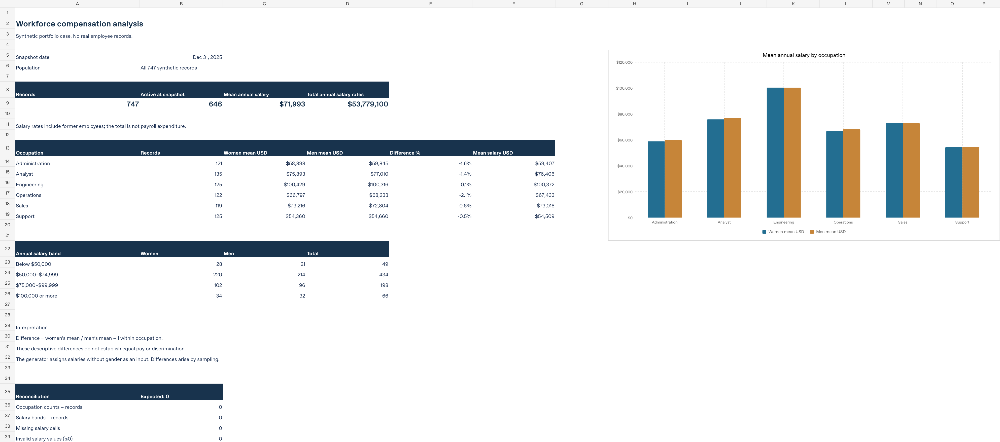

# Workforce Compensation Analysis

An Excel portfolio case study that turns employee-level inputs into an auditable compensation summary. It compares salary distributions by occupation and gender group, calculates employment tenure at a fixed snapshot date, and reconciles every record to the dashboard.

**All 747 records are generated synthetic data.** No real employee records, names, birth dates, contact details or original course data are published. This is a new, privacy-safe reconstruction of skills practiced in CIS 3100, not a reproduction of the original submission's results.



## Open the workbook

Download [workforce-compensation.xlsx](workforce-compensation.xlsx) and open it in Excel. Start with **Compensation**, then inspect the formula inputs on **Synthetic data**. The workbook does not require macros or external data connections.

The snapshot date is **December 31, 2025**. Summary formulas refer to the fixed 747-record range, rows 6–752. Editing records updates the summary and chart; adding rows requires extending the formulas and chart-source summaries. Table filtering does not change the dashboard population.

## What it demonstrates

- `COUNTIF` and `COUNTIFS` for occupation counts, salary-band distributions and employment status.
- `AVERAGEIF` and `AVERAGEIFS` for salary comparisons within occupations.
- Date arithmetic, `IF`, `AND` and `ROUND` for tenure, snapshot status and evaluation averages.
- A native, editable, formula-linked Excel chart rather than a pasted dashboard image.
- Reconciliation checks for headcounts, missing values and invalid salary values.
- A deterministic dataset and independent validation script.

## Reading the results

The demo contains **747 records**, of which **646 are active** at the snapshot. The mean annual salary rate is **$71,993**, and the sum of annual salary rates is **$53,779,100**. The salary summary includes former employees and is **not an estimate of annual payroll spending**.

The comparison is `(women's mean / men's mean) − 1` within each occupation. It is descriptive, not adjusted for role level, location, hours, experience or job responsibilities. It does not establish discrimination or demonstrate equal pay. The generator assigns salary without using gender, so group differences here arise from sampling and occupational composition, not a modeled real-world effect.

The two gender labels are a simplified synthetic scenario, not a complete demographic schema. The five evaluation inputs are synthetic integer scores from 1 to 5; the mean is an arithmetic demonstration, not a hiring or compensation decision rule.

Tenure is elapsed days divided by 365.25, capped at the earlier of termination and the snapshot. It is an approximate fractional-year measure, not completed anniversaries. A person terminating on the snapshot is classified as former. A hire after the snapshot is classified as not yet hired.

## Reproduce and check

```bash
node generate_data.mjs
python verify.py
```

The generator uses a deterministic linear congruential sequence with seed 3100. The generated data intentionally have simple assumptions and are not representative of any real employer. `verify.py` uses only the Python standard library to compare CSV results with the saved workbook, inspect formulas and check native chart references.

The workbook was authored with `@oai/artifact-tool`. `build-workbook.mjs` records the complete authoring workflow; regenerating the XLSX requires a runtime providing that library. Using the delivered workbook and running the independent validation does not require it.

## Validation

The build checked counts, totals, occupation means and reconciliations against independent JavaScript calculations. A controlled salary edit increased the linked mean by the expected amount. Missing salary, zero salary, future-hire and same-day-termination tests passed; all temporary edits were restored. Formula-error scanning found no errors. Both worksheet views were rendered and visually inspected.

The images are rendered workbook previews, not screenshots of a live Excel session. Native Excel recalculation and interaction have not yet been tested on the user's desktop. The workbook is a fixed-size portfolio demonstration, not a production HR system.

## Files

| File | Purpose |
|---|---|
| `workforce-compensation.xlsx` | Formula-linked Excel dashboard and synthetic inputs |
| `synthetic-workforce.csv` | The generated inputs, with ISO dates |
| `generate_data.mjs` | Standalone deterministic data generator |
| `verify.py` | Independent dataset and saved-XLSX checks |
| `build-workbook.mjs` | Auditable workbook-authoring source |
| `validation.json` | Build validation summary |
| `dashboard.png`, `data-preview.png` | Actual workbook renders |

The original coursework file is not included. The public figures are calculated entirely from the synthetic data supplied here.
